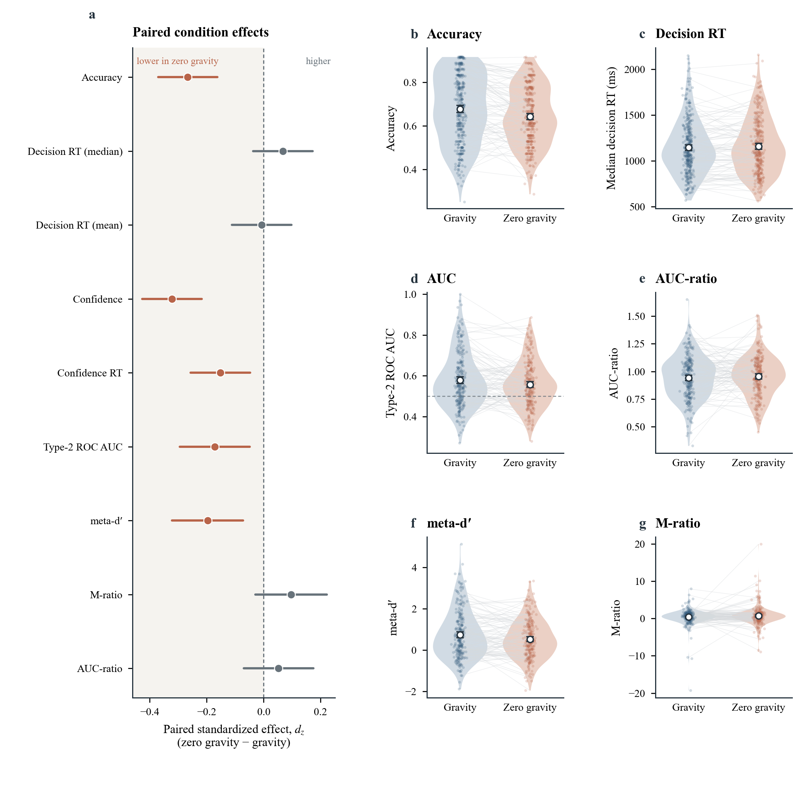
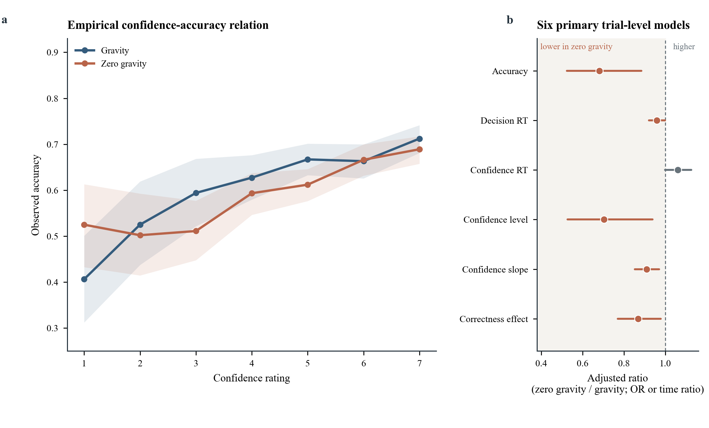
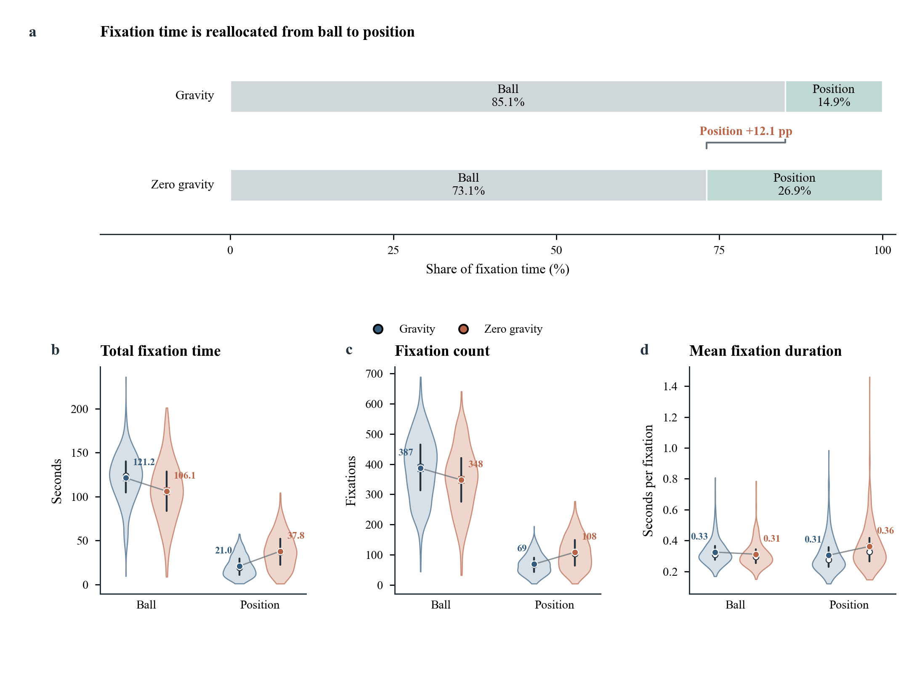
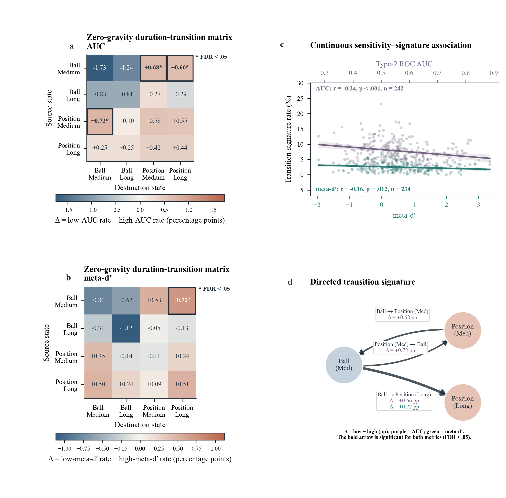
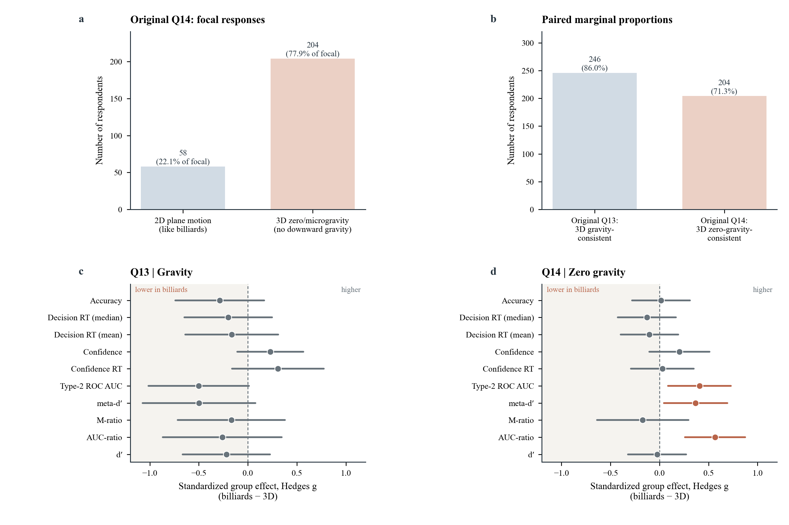
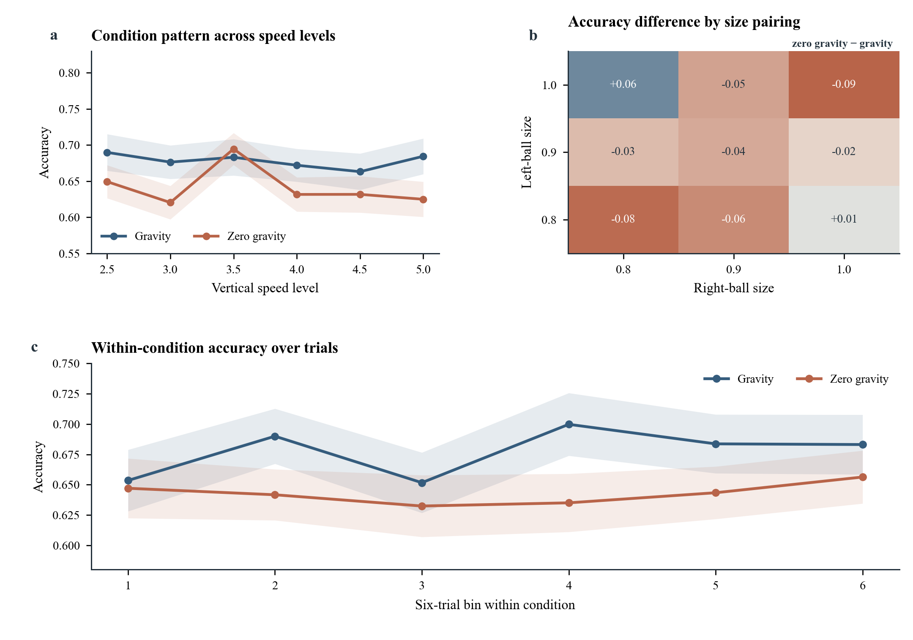
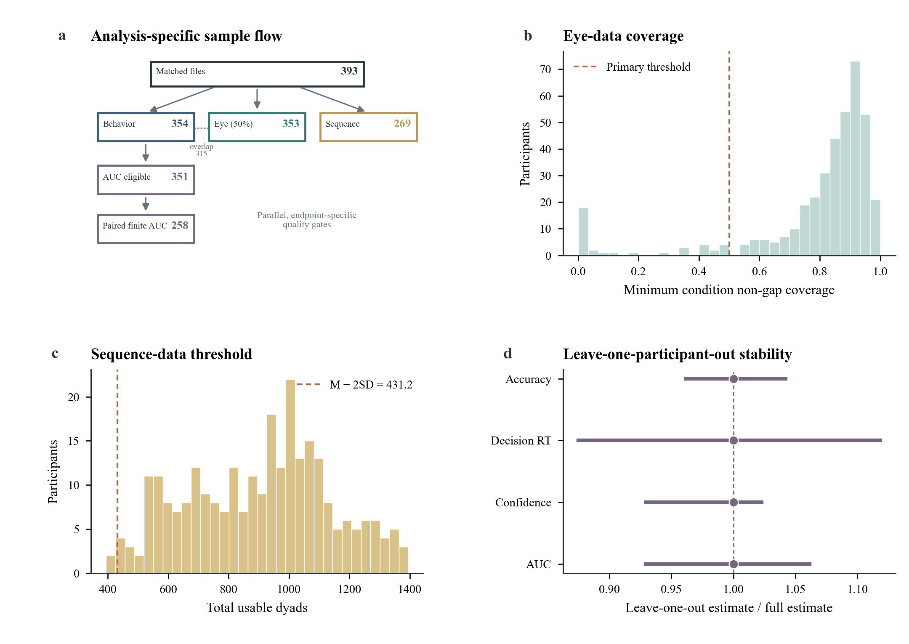

# 轨迹判断与元认知分析报告

生成时间 2026年11月14日 21:51。本报告呈现行为、元认知、眼动和问卷分析结果，各分析分别报告差值方向、样本量及区间。

零重力条件伴随较低的一阶表现、AUC和meta-d′。M-ratio及AUC-ratio的直接条件比较未提供效率下降的明确证据。每条件36试次、稀疏信心计数及接近零的d′会影响个体效率估计，因此效率结论结合共同样本和恢复检查解释。

AUC差异仍可反映一阶知觉证据质量的变化；这些结果不足以据此确认额外的元认知监控受损，也不构成两条件效率等效的证据。效率点估计、区间及对计数结构的敏感性需要共同报告。

## 1 分析范围和指标

主样本由behavioral_data和eye_tracking_data中的393组匹配记录构成。问卷分析使用questionnaire_public/behavioral_data中的286份行为记录，按公开P编号与questionnaire_data_public.csv一对一连接。主样本与问卷行为样本分别应用质量标准并报告分母。

质量控制分别针对行为、信心、眼动和序列数据。SDT使用ExpectedAnswer的0/1作为真实选项类别、UserAnswer的0/1作为选择、整数1–7作为信心；逐条件构建2×2×7原始计数。等方差条件最大似然保留两种选择各自的信心阈值，meta-c=(meta-d′/d′)×c；每格加1/14，与Hautus一阶修正一致。M-ratio=meta-d′/d′，不截断负值或大于1的值。AUC-ratio=观测AUC/相同d′、判准与信心阈值下的SDT期望AUC，恒定信心时AUC按分析规则记为未定义。

对AUC、meta-d′、有符号M-ratio和AUC-ratio分别实施配对条件比较、准确率相关、极端组SPAM/DSM、连续关联及逐人剔除分析。M-ratio与AUC-ratio属于不同构造；AUC-ratio仍可依赖一阶表现，不能视为自动完全消除难度影响。对低d′和36试次下估计精度的检查用于限定解释。

## 2 样本和直接条件比较

| 指标 | 信心计数QC | 有重力有限n | 无重力有限n | 有限配对n |
| --- | --- | --- | --- | --- |
| d′ | 351 | 351 | 351 | 351 |
| Type-2 ROC AUC | 351 | 290 | 272 | 258 |
| meta-d′ | 351 | 287 | 263 | 247 |
| M-ratio | 351 | 287 | 263 | 247 |
| AUC-ratio | 351 | 290 | 272 | 258 |

| 指标 | 配对n | 有重力M | 无重力M | 无−有 | 95% CI | dz | p | BH q |
| --- | --- | --- | --- | --- | --- | --- | --- | --- |
| Accuracy | 354 | 0.678 | 0.642 | -0.035 | [-0.049, -0.022] | -0.266 | < .001 | < .001 |
| Decision RT (median) | 354 | 1145.314 | 1158.392 | 13.077 | [-7.146, 33.301] | 0.068 | 0.204 | 0.255 |
| Decision RT (mean) | 354 | 1260.252 | 1258.934 | -1.318 | [-19.712, 17.076] | -0.007 | 0.888 | 0.888 |
| Mean confidence | 354 | 5.725 | 5.575 | -0.150 | [-0.199, -0.101] | -0.322 | < .001 | < .001 |
| Confidence RT | 354 | 809.557 | 782.010 | -27.547 | [-46.516, -8.578] | -0.152 | 0.005 | 0.009 |
| Type-2 ROC AUC | 258 | 0.579 | 0.557 | -0.022 | [-0.038, -0.006] | -0.171 | 0.006 | 0.011 |
| d′ | 351 | 0.982 | 0.757 | -0.225 | [-0.305, -0.145] | -0.296 | < .001 | < .001 |
| meta-d′ | 247 | 0.748 | 0.530 | -0.218 | [-0.356, -0.079] | -0.197 | 0.002 | 0.005 |
| M-ratio | 247 | 0.381 | 0.698 | 0.317 | [-0.096, 0.730] | 0.096 | 0.132 | 0.188 |
| AUC-ratio | 258 | 0.943 | 0.956 | 0.013 | [-0.017, 0.042] | 0.052 | 0.402 | 0.446 |

主表BH家族包含10个行为及元认知终点；机器表另提供四个元认知终点的BH q。配对t检验为双尾；Wilcoxon与各终点描述统计保留在机器表。恒定信心排除后，AUC的有限配对人数为258，不能用351名计数QC合格人数替代。

M-ratio均值为逐人meta-d′/d′比值的算术平均，不等于两个组均值相除；不同终点使用各自可用配对样本。

图1 行为与元认知条件比较。a为配对标准化差值及缩放后的均值差95% CI，方向为无重力减有重力。右侧第一行b、c为准确率、决策反应时中位数（ms）；第二行d、e为AUC、AUC-ratio；第三行f、g为meta-d′、M-ratio。分布面板显示小提琴分布、配对连线、个体点及均值95% CI。

## 3 效率估计可靠性和敏感性

| 条件 | 拟合状态 | 人数 |
| --- | --- | --- |
| gravity | constant_confidence | 61 |
| gravity | d_prime_near_zero | 3 |
| gravity | ok | 287 |
| gravity | qc_failed | 42 |
| zero_gravity | constant_confidence | 79 |
| zero_gravity | d_prime_near_zero | 9 |
| zero_gravity | ok | 263 |
| zero_gravity | qc_failed | 42 |

| 样本规则 | 指标 | 配对n | 无−有 | 95% CI | p |
| --- | --- | --- | --- | --- | --- |
| all_four_metrics_common_sample | Accuracy | 247 | -0.046 | [-0.062, -0.029] | < .001 |
| all_four_metrics_common_sample | Type-2 ROC AUC | 247 | -0.023 | [-0.039, -0.006] | 0.007 |
| all_four_metrics_common_sample | meta-d′ | 247 | -0.218 | [-0.356, -0.079] | 0.002 |
| all_four_metrics_common_sample | M-ratio | 247 | 0.317 | [-0.096, 0.730] | 0.132 |
| all_four_metrics_common_sample | AUC-ratio | 247 | 0.014 | [-0.017, 0.044] | 0.386 |
| both_abs_dprime_above_0.10 | Accuracy | 304 | -0.037 | [-0.052, -0.022] | < .001 |
| both_abs_dprime_above_0.10 | Type-2 ROC AUC | 230 | -0.025 | [-0.043, -0.008] | 0.005 |
| both_abs_dprime_above_0.10 | meta-d′ | 230 | -0.247 | [-0.392, -0.103] | < .001 |
| both_abs_dprime_above_0.10 | M-ratio | 230 | -0.042 | [-0.347, 0.262] | 0.784 |
| both_abs_dprime_above_0.10 | AUC-ratio | 230 | 0.010 | [-0.021, 0.042] | 0.515 |
| both_dprime_above_0.10 | Accuracy | 238 | -0.047 | [-0.061, -0.033] | < .001 |
| both_dprime_above_0.10 | Type-2 ROC AUC | 189 | -0.025 | [-0.044, -0.005] | 0.015 |
| both_dprime_above_0.10 | meta-d′ | 189 | -0.244 | [-0.410, -0.077] | 0.004 |
| both_dprime_above_0.10 | M-ratio | 189 | 0.047 | [-0.204, 0.298] | 0.712 |
| both_dprime_above_0.10 | AUC-ratio | 189 | 0.015 | [-0.018, 0.048] | 0.364 |

| 固定合并信心等级 | 指标 | n | 无−有 | 95% CI | p |
| --- | --- | --- | --- | --- | --- |
| fixed 1-3/4-5/6-7 confidence pooling | d′ | 351 | -0.225 | [-0.305, -0.145] | < .001 |
| fixed 1-3/4-5/6-7 confidence pooling | meta-d′ | 212 | -0.156 | [-0.332, 0.019] | 0.081 |
| fixed 1-3/4-5/6-7 confidence pooling | M-ratio | 212 | 0.056 | [-0.407, 0.520] | 0.811 |
| original seven levels on coarse-finite common sample | meta-d′ | 212 | -0.247 | [-0.399, -0.095] | 0.002 |
| original seven levels on coarse-finite common sample | M-ratio | 212 | 0.162 | [-0.241, 0.564] | 0.430 |

额外样本规则在两条件使用相同阈值，保留|d′|>.10以及d′>.10的结果；固定信心合并映射为1–3、4–5、6–7。以上是数值稳定性敏感性分析，未经预注册。个体MLE采用等方差条件最大似然，相关计数、拟合状态、似然和条件预测检查分别导出。参数恢复与敏感性分析评价个体估计的精度。

| 恢复情景 | 指标 | 成功/总数 | 真值 | 估计均值 | 偏差 | RMSE |
| --- | --- | --- | --- | --- | --- | --- |
| balanced_d08_M06 | d′ | 191/200 | 0.800 | 0.793 | -0.007 | 0.416 |
| balanced_d08_M06 | meta-d′ | 191/200 | 0.480 | 0.505 | 0.025 | 0.569 |
| balanced_d08_M06 | M-ratio | 191/200 | 0.600 | 0.681 | 0.081 | 1.246 |
| balanced_d12_M06 | d′ | 200/200 | 1.200 | 1.222 | 0.022 | 0.451 |
| balanced_d12_M06 | meta-d′ | 200/200 | 0.720 | 0.737 | 0.017 | 0.663 |
| balanced_d12_M06 | M-ratio | 200/200 | 0.600 | 0.688 | 0.088 | 0.732 |
| highconf_d08_M06 | d′ | 198/200 | 0.800 | 0.825 | 0.025 | 0.403 |
| highconf_d08_M06 | meta-d′ | 198/200 | 0.480 | 0.610 | 0.130 | 0.845 |
| highconf_d08_M06 | M-ratio | 198/200 | 0.600 | 1.027 | 0.427 | 1.884 |
| highconf_d12_M06 | d′ | 200/200 | 1.200 | 1.181 | -0.019 | 0.429 |
| highconf_d12_M06 | meta-d′ | 200/200 | 0.720 | 0.876 | 0.156 | 0.905 |
| highconf_d12_M06 | M-ratio | 200/200 | 0.600 | 0.877 | 0.277 | 1.271 |

恢复模拟每情景200次、每次36试次，比较分散信心和高信心集中两种计数结构，以及d′=.8/1.2；真M-ratio=.6。失败拟合单列，偏差/RMSE条件于成功拟合。分位数表示模拟估计的抽样分布，不能作为真实样本估计的置信区间。

## 4 两类信心模型与一阶表现

| 模型 | 估计目标 | OR | 95% CI | p |
| --- | --- | --- | --- | --- |
| confidence_accuracy_coupling_glmm | zero/gravity ratio of within-participant confidence slopes | 0.910 | [0.853, 0.970] | 0.004 |
| confidence_bias_clmm | zero/gravity ratio of correctness-associated proportional odds | 0.868 | [0.771, 0.978] | 0.020 |

准确率逻辑模型的交互表示同一人信心每提高一级时，正确反应优势的条件间斜率比；有序信心模型的交互表示正确/错误关联的信心分离在条件间的比例优势比。两个模型的结局、链接和条件化方向不同，各自的估计、区间及p值分别陈述。二者均不直接估计已相对于一阶敏感性标准化的效率。

有序信心主分析采用Laplace近似（每维1积分点）、累积logit链接以及被试截距与条件斜率结构。稳定对数概率实现通过独立数值梯度和正定Hessian核对；每维15点积分作为数值敏感性分析，并用21点估计核对参数精度。

| 有序模型 | 积分设置 | 目标OR | 95% CI | p |
| --- | --- | --- | --- | --- |
| confidence_clmm | 主分析 Laplace | 0.703 | [0.527, 0.938] | 0.017 |
| confidence_clmm | 15点积分敏感性 | 0.703 | [0.527, 0.938] | 0.017 |
| confidence_bias_clmm | 主分析 Laplace | 0.868 | [0.771, 0.978] | 0.020 |
| confidence_bias_clmm | 15点积分敏感性 | 0.868 | [0.771, 0.978] | 0.020 |
| interpretation_confidence_clmm | 主分析 Laplace | 0.857 | [0.526, 1.397] | 0.536 |
| interpretation_confidence_clmm | 15点积分敏感性 | 0.858 | [0.526, 1.401] | 0.541 |

高精度积分结果与主分析一并保留，用于评价有序模型对数值近似的敏感性。解释两类信心模型时，以各自的结局、条件化方向、区间和积分设置为依据；相对于一阶敏感性的效率判断另由M-ratio等指标提供。

| 模型/项 | 初始优化输出OR | 初始优化输出p | 稳定似然OR | 稳定似然p |
| --- | --- | --- | --- | --- |
| confidence_clmm / conditionzero_gravity | 0.550 | < .001 | 0.703 | 0.017 |
| confidence_bias_clmm / conditionzero_gravity | 0.794 | 0.009 | 0.855 | 0.105 |
| confidence_bias_clmm / conditionzero_gravity:correct_f1 | 0.940 | 0.390 | 0.868 | 0.020 |

初始有序模型优化输出存在收敛或Hessian问题。表中同时记录初始优化输出与稳定似然估计，模型解释采用通过独立梯度、正定Hessian及15点和21点积分核对的估计。两种数值实现使用相同样本、固定效应、随机截距、条件斜率和Laplace近似。两类信心模型及效率指标分别按照各自的估计目标解释。

图2 原始信心—准确率关系与六类模型估计。后两项分别标明准确率模型和有序信心模型的不同交互；误差线为95% CI。

| 模型终点 | 尺度 | 无/有比率 | 95% CI | p |
| --- | --- | --- | --- | --- |
| Accuracy | odds ratio | 0.681 | [0.524, 0.885] | 0.004 |
| Decision RT | time ratio | 0.959 | [0.920, 0.998] | 0.042 |
| Confidence RT | time ratio | 1.061 | [0.999, 1.126] | 0.056 |
| Confidence level | odds ratio | 0.703 | [0.527, 0.938] | 0.017 |
| Confidence slope | odds ratio | 0.910 | [0.853, 0.970] | 0.004 |
| Correctness effect | odds ratio | 0.868 | [0.771, 0.978] | 0.020 |

前四项模型的条件主效应对应参考速度、尺寸配对及目标侧组合；含条件交互时，这些参考单元效应与全样本未调整配对差值具有不同估计目标。完整协变量及交互系数在behavior_mixed_model_coefficients.csv中。

| 指标 | 条件 | n | Pearson r | p | Spearman ρ | p |
| --- | --- | --- | --- | --- | --- | --- |
| Type-2 ROC AUC | gravity | 290 | 0.430 | < .001 | 0.424 | < .001 |
| Type-2 ROC AUC | zero_gravity | 272 | 0.385 | < .001 | 0.366 | < .001 |
| meta-d′ | gravity | 287 | 0.487 | < .001 | 0.486 | < .001 |
| meta-d′ | zero_gravity | 263 | 0.429 | < .001 | 0.416 | < .001 |
| M-ratio | gravity | 287 | 0.078 | 0.186 | 0.137 | 0.020 |
| M-ratio | zero_gravity | 263 | -0.003 | 0.964 | 0.088 | 0.156 |
| AUC-ratio | gravity | 290 | -0.344 | < .001 | -0.271 | < .001 |
| AUC-ratio | zero_gravity | 272 | -0.342 | < .001 | -0.280 | < .001 |

## 5 眼动和探索性序列结果

| 覆盖阈值 | n | 位置区占比增加百分点 | 95% CI | p |
| --- | --- | --- | --- | --- |
| 0.400 | 363 | 11.833 | [10.197, 13.470] | < .001 |
| 0.500 | 353 | 12.051 | [10.393, 13.710] | < .001 |
| 0.600 | 343 | 12.174 | [10.490, 13.858] | < .001 |

图3 注视分配、各区域时长及次数。原始尺度与相应95% CI分别呈现；条件比较方向保持一致。

| 指标 | 表示 | 条件 | 低/高组n | FDR显著dyad数 |
| --- | --- | --- | --- | --- |
| Type-2 ROC AUC | duration | gravity | 63/64 | 0 |
| Type-2 ROC AUC | duration | zero_gravity | 60/61 | 3 |
| Type-2 ROC AUC | event | gravity | 63/64 | 0 |
| Type-2 ROC AUC | event | zero_gravity | 60/61 | 0 |
| AUC-ratio | duration | gravity | 64/64 | 0 |
| AUC-ratio | duration | zero_gravity | 61/61 | 0 |
| AUC-ratio | event | gravity | 64/64 | 0 |
| AUC-ratio | event | zero_gravity | 61/61 | 0 |
| M-ratio | duration | gravity | 64/64 | 0 |
| M-ratio | duration | zero_gravity | 59/59 | 0 |
| M-ratio | event | gravity | 64/64 | 0 |
| M-ratio | event | zero_gravity | 59/59 | 0 |
| meta-d′ | duration | gravity | 64/64 | 0 |
| meta-d′ | duration | zero_gravity | 59/59 | 1 |
| meta-d′ | event | gravity | 64/64 | 0 |
| meta-d′ | event | zero_gravity | 59/59 | 0 |

| 指标 | 条件 | 转移 | 低/高组n | 低−高百分点 | 95% CI | BH q |
| --- | --- | --- | --- | --- | --- | --- |
| Type-2 ROC AUC | zero_gravity | ball_MED->position_LONG | 60/61 | 0.659 | [0.243, 1.081] | 0.021 |
| Type-2 ROC AUC | zero_gravity | ball_MED->position_MED | 60/61 | 0.681 | [0.264, 1.111] | 0.021 |
| Type-2 ROC AUC | zero_gravity | position_MED->ball_MED | 60/61 | 0.719 | [0.237, 1.197] | 0.021 |
| meta-d′ | zero_gravity | ball_MED->position_LONG | 59/59 | 0.723 | [0.272, 1.200] | 0.045 |

序列组间区间采用3500次组内参与者bootstrap，随机种子为20260716（基础种子20260713加3）。每项元认知指标独立初始化同一随机种子，选中转移按BH校正p值及转移名称排序。

每个指标分别按本条件Q1/Q3严格低于/高于分组，并在其自身候选样本中重算M−2SD的dyad QC。BH校正在各指标、条件及event/duration表示内分别进行，每项置换5000次；另提供跨四指标校正列。不同指标的结果来自同一批原始数据，不能当作独立重复实验。

| 指标 | 表示 | 条件 | dyad | n | 连续斜率 | BH q |
| --- | --- | --- | --- | --- | --- | --- |
| Type-2 ROC AUC | event | zero_gravity | ball->position | 242 | -0.052 | 0.027 |
| Type-2 ROC AUC | event | zero_gravity | position->ball | 242 | -0.051 | 0.027 |
| Type-2 ROC AUC | duration | zero_gravity | ball_MED->position_LONG | 242 | -0.027 | 0.005 |
| Type-2 ROC AUC | duration | zero_gravity | ball_MED->position_MED | 242 | -0.024 | 0.014 |
| Type-2 ROC AUC | duration | zero_gravity | position_MED->ball_MED | 242 | -0.024 | 0.021 |
| meta-d′ | duration | gravity | ball_MED->ball_MED | 254 | 0.006 | 0.039 |
| meta-d′ | duration | gravity | ball_MED->position_MED | 254 | -0.002 | 0.025 |
| meta-d′ | duration | zero_gravity | ball_MED->position_LONG | 234 | -0.003 | 0.037 |
| meta-d′ | duration | zero_gravity | ball_MED->position_MED | 234 | -0.003 | 0.037 |

连续回归采用HC3稳健标准误。选中dyad相加得到的转移特征与指标的相关属于同数据后选择描述；完整相关、样本量及选中转移在scanpath_signature_associations_by_metric.csv中。

图4 探索性序列结果。a、b分别为AUC与meta-d′的无重力duration转移矩阵，数值为各指标低组减高组的百分点；星号与边框表示相应家族FDR<.05。c为连续关联，紫色AUC使用上方横轴，绿色meta-d′使用下方横轴；散点与回归线描述指标和转移特征的连续关联，区间为95% CI。d为有向转移网络，第三条加粗箭头表示两指标共同通过FDR的Ball Medium→Position Long转移；框中紫色差值为AUC、绿色差值为meta-d′，单位为低组减高组的百分点。连续关联属于同数据后选择描述。

## 6 问卷的两项主要组间比较

问卷的主要比较为：按Q13回答独立划分三维重力理解组与二维台球式组，比较其在重力条件下的表现；按Q14回答重新分组，比较三维零/微重力理解组与二维台球式组在无重力条件下的表现。两项比较均包含全部10项指标，包括AUC、meta-d′、有符号M-ratio和AUC-ratio。每项比较独立应用相应条件QC，不要求另一条件合格。统计单位为参与者，使用Welch双尾t、95% CI和Hedges g；方向为二维台球式减三维理解。

| 比较 | 指标 | 3D/台球n | 3D M | 台球M | 台球−3D | 95% CI | p | BH q |
| --- | --- | --- | --- | --- | --- | --- | --- | --- |
| 3D gravity understanding vs two-dimensional billiards-like group in gravity condition | Accuracy | 230/25 | 0.659 | 0.618 | -0.041 | [-0.106, 0.024] | 0.206 | 0.411 |
| 3D gravity understanding vs two-dimensional billiards-like group in gravity condition | Decision RT (median) | 230/25 | 1106.259 | 1051.099 | -55.160 | [-178.693, 68.373] | 0.369 | 0.481 |
| 3D gravity understanding vs two-dimensional billiards-like group in gravity condition | Decision RT (mean) | 230/25 | 1207.127 | 1161.926 | -45.201 | [-175.841, 85.438] | 0.484 | 0.532 |
| 3D gravity understanding vs two-dimensional billiards-like group in gravity condition | Mean confidence | 226/25 | 5.597 | 5.898 | 0.301 | [-0.142, 0.744] | 0.177 | 0.411 |
| 3D gravity understanding vs two-dimensional billiards-like group in gravity condition | Confidence RT | 226/25 | 689.253 | 783.130 | 93.877 | [-49.040, 236.794] | 0.189 | 0.411 |
| 3D gravity understanding vs two-dimensional billiards-like group in gravity condition | Type-2 ROC AUC | 165/22 | 0.562 | 0.503 | -0.060 | [-0.121, 0.002] | 0.056 | 0.411 |
| 3D gravity understanding vs two-dimensional billiards-like group in gravity condition | meta-d′ | 159/22 | 0.637 | 0.099 | -0.538 | [-1.160, 0.083] | 0.086 | 0.411 |
| 3D gravity understanding vs two-dimensional billiards-like group in gravity condition | M-ratio | 159/22 | 0.563 | 0.144 | -0.419 | [-1.781, 0.944] | 0.532 | 0.532 |
| 3D gravity understanding vs two-dimensional billiards-like group in gravity condition | AUC-ratio | 165/22 | 0.952 | 0.906 | -0.046 | [-0.152, 0.061] | 0.385 | 0.481 |
| 3D gravity understanding vs two-dimensional billiards-like group in gravity condition | d′ | 226/25 | 0.837 | 0.663 | -0.174 | [-0.528, 0.180] | 0.324 | 0.481 |
| 3D zero/microgravity understanding vs two-dimensional billiards-like group in zero_gravity condition | Accuracy | 196/54 | 0.657 | 0.659 | 0.002 | [-0.037, 0.041] | 0.917 | 0.917 |
| 3D zero/microgravity understanding vs two-dimensional billiards-like group in zero_gravity condition | Decision RT (median) | 196/54 | 1197.526 | 1158.375 | -39.152 | [-129.472, 51.168] | 0.391 | 0.691 |
| 3D zero/microgravity understanding vs two-dimensional billiards-like group in zero_gravity condition | Decision RT (mean) | 196/54 | 1308.055 | 1278.648 | -29.407 | [-112.532, 53.719] | 0.484 | 0.691 |
| 3D zero/microgravity understanding vs two-dimensional billiards-like group in zero_gravity condition | Mean confidence | 195/52 | 5.557 | 5.813 | 0.255 | [-0.133, 0.643] | 0.195 | 0.486 |
| 3D zero/microgravity understanding vs two-dimensional billiards-like group in zero_gravity condition | Confidence RT | 195/52 | 803.511 | 812.387 | 8.876 | [-90.688, 108.441] | 0.860 | 0.917 |
| 3D zero/microgravity understanding vs two-dimensional billiards-like group in zero_gravity condition | Type-2 ROC AUC | 156/45 | 0.531 | 0.578 | 0.046 | [0.010, 0.083] | 0.013 | 0.066 |
| 3D zero/microgravity understanding vs two-dimensional billiards-like group in zero_gravity condition | meta-d′ | 153/43 | 0.379 | 0.741 | 0.362 | [0.043, 0.681] | 0.027 | 0.089 |
| 3D zero/microgravity understanding vs two-dimensional billiards-like group in zero_gravity condition | M-ratio | 153/43 | 0.490 | -0.019 | -0.509 | [-1.893, 0.875] | 0.463 | 0.691 |
| 3D zero/microgravity understanding vs two-dimensional billiards-like group in zero_gravity condition | AUC-ratio | 156/45 | 0.908 | 1.008 | 0.100 | [0.046, 0.155] | < .001 | 0.004 |
| 3D zero/microgravity understanding vs two-dimensional billiards-like group in zero_gravity condition | d′ | 195/52 | 0.832 | 0.813 | -0.019 | [-0.245, 0.207] | 0.868 | 0.917 |

主要结论采用每个问题/条件全部10项终点的BH校正；四项元认知指标另有补充校正。问卷在任务后填写，组间差别反映探索性关联。逐终点保留过程和全体286条一对一匹配审计在questionnaire_public/questionnaire_outputs内。

Q13（重力条件）的四项元认知结果，采用本题全部10项终点BH校正：Type-2 ROC AUC：台球−三维差值=-0.060，95% CI [-0.121, 0.002]，BH q=0.411；meta-d′：台球−三维差值=-0.538，95% CI [-1.160, 0.083]，BH q=0.411；有符号 M-ratio：台球−三维差值=-0.419，95% CI [-1.781, 0.944]，BH q=0.532；AUC-ratio：台球−三维差值=-0.046，95% CI [-0.152, 0.061]，BH q=0.481。

Q13的全部10项指标在该校正下均未达显著。

Q14（无重力条件）的四项元认知结果，采用本题全部10项终点BH校正：Type-2 ROC AUC：台球−三维差值=0.046，95% CI [0.010, 0.083]，BH q=0.066；meta-d′：台球−三维差值=0.362，95% CI [0.043, 0.681]，BH q=0.089；有符号 M-ratio：台球−三维差值=-0.509，95% CI [-1.893, 0.875]，BH q=0.691；AUC-ratio：台球−三维差值=0.100，95% CI [0.046, 0.155]，BH q=0.004。

Q14通过本题10项BH校正的指标为AUC-ratio；其余指标未达显著。

图S4 问卷选择分布及任务理解组间差别。上方a为Q14两个焦点选项：二维台球式58/262（22.1%），三维零/微重力204/262（77.9%）；b为全体286人的三维理解选择：Q13为246/286（86.0%），Q14为204/286（71.3%）。下方c、d分别为Q13有重力和Q14无重力的组间比较；点为Hedges g，误差线为Welch均值差95% CI按同一合并标准差及小样本修正缩放，方向为二维台球式减三维理解。完整组间统计与校正见表格。

## 7 补充的条件与任务理解交互分析

在上述两项条件内比较之外，另对Q14分组实施条件×理解组补充检验。准确率GLMM和有序信心CLMM包含速度、方向性尺寸配对、目标侧、线性和二次试次进程、条件与速度及尺寸交互，以及被试随机截距和条件斜率；AUC、meta-d′、有符号M-ratio和AUC-ratio比较同一参与者的无重力减重力差值，使用异方差组间检验及5000次组内参与者bootstrap。六项交互检验统一使用六终点BH校正。

| 终点 | 3D/台球n | 交互/差异之差 | 95% CI | p | 六终点BH q |
| --- | --- | --- | --- | --- | --- |
| Type-2 ROC AUC | 123/36 | 0.054 | [0.002, 0.106] | 0.040 | 0.121 |
| meta-d′ | 117/33 | 0.235 | [-0.254, 0.724] | 0.338 | 0.507 |
| M-ratio | 117/33 | -1.218 | [-3.190, 0.754] | 0.219 | 0.439 |
| AUC-ratio | 123/36 | 0.103 | [0.018, 0.187] | 0.018 | 0.110 |
| Accuracy | 185/52 | 0.977 | [0.806, 1.186] | 0.817 | 0.817 |
| confidence | 185/52 | 0.857 | [0.526, 1.397] | 0.536 | 0.644 |

模型交互在OR尺度上，无参数汇总指标的交互在原始差异之差尺度上；它们的零点分别为1和0。标准化预测及其条件差异另存questionnaire_moderation_standardized_predictions/contrasts.csv，解释时不以一组显著而另一组不显著代替直接交互检验。

Q14条件内比较中，AUC-ratio通过10终点BH校正；AUC和meta-d′仅在四元认知终点家族内通过校正。条件×理解的直接调节中，AUC和AUC-ratio的原始p值小于.05，校正后均未达到.05。准确率、信心、meta-d′及M-ratio的直接调节检验未达到.05。

## 8 设计敏感性与复杂模型模拟功效

| 情景真OR | 模拟次数 | 可用/失败 | 总分母检出率 | MC SE | 成功拟合覆盖率 | 偏差 | RMSE |
| --- | --- | --- | --- | --- | --- | --- | --- |
| 1.000 | 100 | 100/0 | 0.020 | 0.014 | 0.980 | 0.001 | 0.031 |
| 0.900 | 100 | 100/0 | 0.900 | 0.030 | 0.950 | 0.001 | 0.031 |

复杂模型模拟采用实际信心—准确率GLMM的试次设计、任务协变量及随机效应协方差。每次重新生成参与者随机效应和二项结局，并用同一模型公式重新拟合。条件×信心交互设为OR=1和OR=.90，各100次；其余参数根据实际拟合结果设定。非收敛、奇异及错误拟合计入总分母并单列，检出率同时给Monte Carlo误差。

| 终点 | 实际有效n | 80%可检出dz | dz=.10模拟检出率 | dz=.20模拟检出率 | dz=.30模拟检出率 |
| --- | --- | --- | --- | --- | --- |
| Accuracy | 354 | 0.149 | 0.467 | 0.960 | 1.000 |
| Decision RT (median) | 354 | 0.149 | 0.467 | 0.960 | 1.000 |
| Decision RT (mean) | 354 | 0.149 | 0.467 | 0.960 | 1.000 |
| Mean confidence | 354 | 0.149 | 0.467 | 0.960 | 1.000 |
| Confidence RT | 354 | 0.149 | 0.467 | 0.960 | 1.000 |
| Type-2 ROC AUC | 258 | 0.175 | 0.356 | 0.894 | 0.998 |
| d′ | 351 | 0.150 | 0.464 | 0.966 | 1.000 |
| meta-d′ | 247 | 0.179 | 0.361 | 0.887 | 0.997 |
| M-ratio | 247 | 0.179 | 0.361 | 0.887 | 0.997 |
| AUC-ratio | 258 | 0.175 | 0.356 | 0.894 | 0.998 |

配对设计另以每终点实际有效n、假设dz=0/.10/.20/.30各5000次正态差值模拟，并与非中心t解析功效核对。以上评价已完成设计对假设效应的敏感性。

## 9 稳健性结果和复现入口

图S1 速度、尺寸配对和试次进程结果。模型使用实际行顺序的线性/二次项，解释范围保持一致。

图S2 样本流、眼动覆盖、序列QC和逐人剔除。四项元认知指标的逐人剔除表位于metacognition_leave_one_subject_out.csv。

| 指标 | n | 完整差值 | 逐人剔除最小值 | 最大值 | 方向保持 |
| --- | --- | --- | --- | --- | --- |
| Type-2 ROC AUC | 258 | -0.022 | -0.024 | -0.021 | 是 |
| meta-d′ | 247 | -0.218 | -0.229 | -0.203 | 是 |
| M-ratio | 247 | 0.317 | 0.229 | 0.360 | 是 |
| AUC-ratio | 258 | 0.013 | 0.010 | 0.016 | 是 |

决策时间限制为200–5000 ms后，n=354，配对中位数差值13.169 ms，95% CI [-7.053, 33.391]，p=0.201。完整任务因素、遮挡时长及眼动模型系数与诊断均保存在下列机器表中。

完整运行命令为python run_analysis.py。已拟合的R模型可在直接核对输入表相等后用--reuse-models复用；模拟按scenario/replicate checkpoint续接。默认运行会生成全部主分析、问卷比较及调节、模拟、图片和本报告。

## 10 方法依据和结果表目录

Maniscalco & Lau (2012): https://doi.org/10.1016/j.concog.2011.09.021；Fleming (2017): https://doi.org/10.1093/nc/nix007；Rahnev (2025): https://doi.org/10.1038/s41467-025-56117-0。AUC-ratio按SDT预期AUC对观测AUC进行归一化，方法依据Rahnev（2025）。

主分析表（完整机器可读结果）：

- [accuracy_auc_correlations.csv](../tables/accuracy_auc_correlations.csv)
- [accuracy_metacognition_correlations.csv](../tables/accuracy_metacognition_correlations.csv)
- [behavior_file_audit.csv](../tables/behavior_file_audit.csv)
- [behavior_mixed_model_coefficients.csv](../tables/behavior_mixed_model_coefficients.csv)
- [behavior_model_diagnostics.csv](../tables/behavior_model_diagnostics.csv)
- [behavior_qc_by_condition.csv](../tables/behavior_qc_by_condition.csv)
- [confidence_bias_clmm_agq15_sensitivity_coefficients.csv](../tables/confidence_bias_clmm_agq15_sensitivity_coefficients.csv)
- [confidence_bias_clmm_quadrature_checks.csv](../tables/confidence_bias_clmm_quadrature_checks.csv)
- [confidence_bias_clmm_stable_coefficients.csv](../tables/confidence_bias_clmm_stable_coefficients.csv)
- [confidence_bias_clmm_stable_covariance.csv](../tables/confidence_bias_clmm_stable_covariance.csv)
- [confidence_bias_clmm_stable_diagnostics.csv](../tables/confidence_bias_clmm_stable_diagnostics.csv)
- [confidence_clmm_agq15_sensitivity_coefficients.csv](../tables/confidence_clmm_agq15_sensitivity_coefficients.csv)
- [confidence_clmm_quadrature_checks.csv](../tables/confidence_clmm_quadrature_checks.csv)
- [confidence_clmm_stable_coefficients.csv](../tables/confidence_clmm_stable_coefficients.csv)
- [confidence_clmm_stable_covariance.csv](../tables/confidence_clmm_stable_covariance.csv)
- [confidence_clmm_stable_diagnostics.csv](../tables/confidence_clmm_stable_diagnostics.csv)
- [coupling_joint_interpretation.csv](../tables/coupling_joint_interpretation.csv)
- [dsm_continuous_auc_sensitivity.csv](../tables/dsm_continuous_auc_sensitivity.csv)
- [dsm_continuous_by_metric.csv](../tables/dsm_continuous_by_metric.csv)
- [dsm_results_all.csv](../tables/dsm_results_all.csv)
- [dsm_results_by_metric.csv](../tables/dsm_results_by_metric.csv)
- [duration_dyad_subject_rates.csv](../tables/duration_dyad_subject_rates.csv)
- [duration_dyad_subject_rates_by_metric.csv](../tables/duration_dyad_subject_rates_by_metric.csv)
- [event_dyad_subject_rates.csv](../tables/event_dyad_subject_rates.csv)
- [event_dyad_subject_rates_by_metric.csv](../tables/event_dyad_subject_rates_by_metric.csv)
- [eye_coverage_threshold_sensitivity.csv](../tables/eye_coverage_threshold_sensitivity.csv)
- [eye_file_errors.csv](../tables/eye_file_errors.csv)
- [eye_metrics_subject_condition_region.csv](../tables/eye_metrics_subject_condition_region.csv)
- [eye_mixed_model_coefficients.csv](../tables/eye_mixed_model_coefficients.csv)
- [eye_model_diagnostics.csv](../tables/eye_model_diagnostics.csv)
- [eye_qc_by_condition.csv](../tables/eye_qc_by_condition.csv)
- [figure1_standardized_effects.csv](../tables/figure1_standardized_effects.csv)
- [figure2_confidence_calibration.csv](../tables/figure2_confidence_calibration.csv)
- [figure2_key_model_coefficients.csv](../tables/figure2_key_model_coefficients.csv)
- [figure3_direct_eye_metric_summary.csv](../tables/figure3_direct_eye_metric_summary.csv)
- [figure3_eye_condition_ratios.csv](../tables/figure3_eye_condition_ratios.csv)
- [figure3_position_share_change_subject.csv](../tables/figure3_position_share_change_subject.csv)
- [figure4_significant_dyad_bootstrap.csv](../tables/figure4_significant_dyad_bootstrap.csv)
- [figure4_transition_signature_model.csv](../tables/figure4_transition_signature_model.csv)
- [figure4_transition_signature_subject.csv](../tables/figure4_transition_signature_subject.csv)
- [figure4_zero_gravity_transition_matrix.csv](../tables/figure4_zero_gravity_transition_matrix.csv)
- [figureS1_size_pair_accuracy_difference.csv](../tables/figureS1_size_pair_accuracy_difference.csv)
- [figureS1_trial_progress_accuracy.csv](../tables/figureS1_trial_progress_accuracy.csv)
- [figureS1_velocity_accuracy.csv](../tables/figureS1_velocity_accuracy.csv)
- [figureS2_leave_one_out_stability.csv](../tables/figureS2_leave_one_out_stability.csv)
- [figureS4_questionnaire_response_counts.csv](../tables/figureS4_questionnaire_response_counts.csv)
- [file_matching_audit.csv](../tables/file_matching_audit.csv)
- [interpretation_confidence_clmm_agq15_sensitivity_coefficients.csv](../tables/interpretation_confidence_clmm_agq15_sensitivity_coefficients.csv)
- [interpretation_confidence_clmm_quadrature_checks.csv](../tables/interpretation_confidence_clmm_quadrature_checks.csv)
- [interpretation_confidence_clmm_stable_coefficients.csv](../tables/interpretation_confidence_clmm_stable_coefficients.csv)
- [interpretation_confidence_clmm_stable_covariance.csv](../tables/interpretation_confidence_clmm_stable_covariance.csv)
- [interpretation_confidence_clmm_stable_diagnostics.csv](../tables/interpretation_confidence_clmm_stable_diagnostics.csv)
- [leave_one_subject_out_stability.csv](../tables/leave_one_subject_out_stability.csv)
- [metacognition_leave_one_subject_out.csv](../tables/metacognition_leave_one_subject_out.csv)
- [metad_condition_contrasts.csv](../tables/metad_condition_contrasts.csv)
- [metad_fit_status_counts.csv](../tables/metad_fit_status_counts.csv)
- [metad_input_counts.csv](../tables/metad_input_counts.csv)
- [metad_mle_subject_condition.csv](../tables/metad_mle_subject_condition.csv)
- [metad_parameter_recovery.csv](../tables/metad_parameter_recovery.csv)
- [metad_predictive_checks.csv](../tables/metad_predictive_checks.csv)
- [metad_sample_flow.csv](../tables/metad_sample_flow.csv)
- [metad_sensitivity.csv](../tables/metad_sensitivity.csv)
- [metad_three_level_sensitivity.csv](../tables/metad_three_level_sensitivity.csv)
- [metad_three_level_sensitivity_subject.csv](../tables/metad_three_level_sensitivity_subject.csv)
- [mixed_model_power_summary.csv](../tables/mixed_model_power_summary.csv)
- [ordinal_optimizer_comparison.csv](../tables/ordinal_optimizer_comparison.csv)
- [paired_condition_effects.csv](../tables/paired_condition_effects.csv)
- [paired_design_sensitivity.csv](../tables/paired_design_sensitivity.csv)
- [participant_condition_summary.csv](../tables/participant_condition_summary.csv)
- [r_model_status.csv](../tables/r_model_status.csv)
- [rt_sensitivity.csv](../tables/rt_sensitivity.csv)
- [sample_flow.csv](../tables/sample_flow.csv)
- [scanpath_selected_contrasts_by_metric.csv](../tables/scanpath_selected_contrasts_by_metric.csv)
- [scanpath_signature_associations_by_metric.csv](../tables/scanpath_signature_associations_by_metric.csv)
- [scanpath_signatures_by_metric.csv](../tables/scanpath_signatures_by_metric.csv)
- [spam_dsm_dyad_qc.csv](../tables/spam_dsm_dyad_qc.csv)
- [spam_dsm_qc_by_metric.csv](../tables/spam_dsm_qc_by_metric.csv)
- [spam_support_summary.csv](../tables/spam_support_summary.csv)
- [stimulus_generation_checks.csv](../tables/stimulus_generation_checks.csv)

问卷输出（完整机器可读结果）：

- [questionnaire_all_conditions_metrics.csv](../../questionnaire_public/questionnaire_outputs/questionnaire_all_conditions_metrics.csv)
- [questionnaire_group_comparisons.csv](../../questionnaire_public/questionnaire_outputs/questionnaire_group_comparisons.csv)
- [questionnaire_match_audit_public.csv](../../questionnaire_public/questionnaire_outputs/questionnaire_match_audit_public.csv)
- [questionnaire_model_diagnostics.csv](../../questionnaire_public/questionnaire_outputs/questionnaire_model_diagnostics.csv)
- [questionnaire_moderation_model_coefficients.csv](../../questionnaire_public/questionnaire_outputs/questionnaire_moderation_model_coefficients.csv)
- [questionnaire_moderation_model_diagnostics.csv](../../questionnaire_public/questionnaire_outputs/questionnaire_moderation_model_diagnostics.csv)
- [questionnaire_moderation_paired_subject.csv](../../questionnaire_public/questionnaire_outputs/questionnaire_moderation_paired_subject.csv)
- [questionnaire_moderation_standardized_contrasts.csv](../../questionnaire_public/questionnaire_outputs/questionnaire_moderation_standardized_contrasts.csv)
- [questionnaire_moderation_standardized_predictions.csv](../../questionnaire_public/questionnaire_outputs/questionnaire_moderation_standardized_predictions.csv)
- [questionnaire_moderation_summary.csv](../../questionnaire_public/questionnaire_outputs/questionnaire_moderation_summary.csv)
- [questionnaire_sample_flow.csv](../../questionnaire_public/questionnaire_outputs/questionnaire_sample_flow.csv)
- [questionnaire_subject_metrics.csv](../../questionnaire_public/questionnaire_outputs/questionnaire_subject_metrics.csv)
- [questionnaire_trial_model_input.csv](../../questionnaire_public/questionnaire_outputs/questionnaire_trial_model_input.csv)
